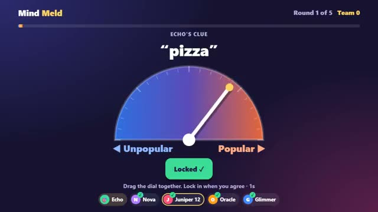

# Mind Meld

One clue. One dial. How in sync is your team? A multiplayer starter game from [Multiplayer Agent](https://multiplayeragent.com): 2D, party, 2–10 players, with bots that fill empty seats.

## How it plays

Each round one player, the clue-giver, secretly sees a target somewhere on a dial between two opposites, like *cold* and *hot* or *underrated* and *overrated*. They give a short clue ("soup"). Everyone else turns the same shared dial together and locks in. The closer the needle lands to the target, the more points the team gets: 4 for a bullseye, then 3 and 2. Everyone gives one clue per game.

**Controls:** Drag the dial (or use the arrow keys) and press Lock in (or Enter). The clue-giver types a clue.

## Make it yours in the Game Builder

Open the [Game Builder](https://multiplayeragent.com), choose **Start from a starter game** and pick Mind Meld. It opens as version 1 in your studio, ready to play and publish. Then ask for changes, for example:

- Add a card pack about food
- Let the other team guess left or right for a bonus point
- Make a bullseye shower the screen with confetti

## Run it yourself

1. Get a free publishable key (`pk_…`) at [multiplayeragent.com](https://multiplayeragent.com).
2. In `index.html`, put it in place of `pk_REPLACE_ME` in the `MP_CONNECT` block.
3. Open `index.html` in a browser. No build step and no server needed.

Without a key it still runs, offline against bots.

## How it is built

- One `index.html`. The comment at the top of the script maps the code and explains the multiplayer.
- **Hidden info:** The target is sealed so only the clue-giver can read it (the host deals, so it can too).
- **Host-run rounds:** The host's browser deals the cards, runs the timers and scores each round; if it leaves, the next player takes over.
- **Live sync:** Everyone turns one shared dial; the host applies every turn and everyone sees the needle move.
- **Bots:** Bots give clues from each card's examples and turn the dial until enough people join.
- **Leaderboard:** The team's best total in one game.
- The spectrum cards are in the `CARDS` section: two opposites plus three example clues the bots use.
- `?attract` runs it offline with bots only. The preview video is recorded from it.

## License

MIT.
